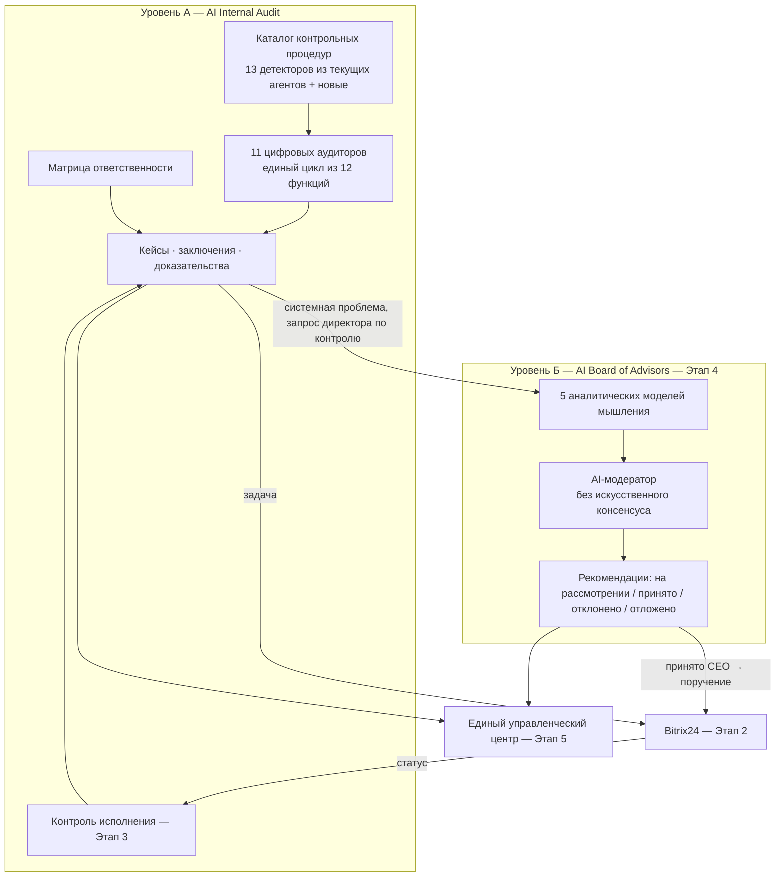

# Аудит текущей системы и технический план Этапа 1

Версия 0.1 · 2026-10-17 · ветка `claude/trusting-edison-t71qhf` (коммит `652d54a`).
Основа: [`control-audit.md`](control-audit.md) — его архитектура, 16 агентов,
12 сценариев, кейсы и журнал сохраняются и развиваются, а не переписываются.

Статус: **ожидает согласования**. Код Этапа 1 не начат.

---

## Часть 1. Аудит существующей системы

### 1.1. Что реализовано

| Компонент | Где | Состояние |
|---|---|---|
| Next.js 14 портал, брендовый тёмно-зелёный дизайн | `src/app/portal/page.tsx` | Работает |
| Центр контроля: KPI, тепловая карта, топ рисков, drill-down до кейса | `src/components/control/ControlTower.tsx` | Работает на демо-данных |
| Типизированный контракт: агент-манифест, кейс, согласование, журнал | `src/lib/control/types.ts` | Готов, нужен к расширению |
| Матрица полномочий L0–L3 + «только человек», `validateManifest`, `approvalOutcome` | `src/lib/control/policy.ts` | Готова, логика верная |
| Риск-скоринг объектов (прозрачная формула) | `src/lib/control/policy.ts` | Готов, веса — допущение |
| Реестр 16 агентов (13 полей каждый) | `src/lib/control/registry.ts` | Готов как описание |
| 12 сквозных сценариев | `src/lib/control/scenarios.ts` | Готовы как описание |
| Модуль репутации 2GIS (главная `/`, `/portal/reputation`) | `src/app/page.tsx`, `src/components/dashboard/*` | Работает на зашитых данных |
| Деплой | Azure Static Web Apps, GitHub Actions на `main` | Работает |

### 1.2. Что работает только как интерфейс или демонстрация

| Функция | Как сейчас на самом деле |
|---|---|
| Кейсы, объекты, сигналы | Статический массив `demo.ts`. Агенты **ничего не вычисляют** — они существуют как описания |
| Согласования | Состояние React в браузере. **Теряются при перезагрузке** — подтверждённая проблема |
| Журнал действий | Массив в памяти + демо-записи. Не неизменяемый, не хранится |
| «Создание задачи в Bitrix24» | Нигде не происходит; в журнале — демо-строки |
| Роль согласующего | Переключатель в интерфейсе: любой может нажать «Согласовать» за любую роль |
| Подсказки МОЗГ | Статический текст в `MOZG` (portal/page.tsx) |
| «Совет директоров» (`board`) | Статическая страница: 5 персон (Маск, Джобс, Сейсембаев, Имаи, Турлов), **цитаты в кавычках, которые не являются подтверждёнными высказываниями этих людей**, «голосования 5:0 / 4:1» и «решение принято» |
| «AI-генератор ответов» на отзывы | Шаблоны по категории, LLM не используется |
| Настройки (ключ 2GIS, Telegram, e-mail) | Поля ввода; ничего не сохраняется |
| Данные репутации | Зашиты в `data.ts` и `reputation/page.tsx` |
| Supabase | Только счётчик непрочитанных, вызывается из браузера по публичному ключу |

### 1.3. Что требует серверной части

Всё, что должно переживать перезагрузку, быть доказательным или выполняться
без открытого браузера:

1. Хранение кейсов, доказательств, заключений, согласований, решений совета.
2. Аутентификация и проверка прав **на сервере** (сейчас прав нет вообще).
3. Неизменяемый журнал (append-only + хэш-цепочка).
4. Хранилище файлов-доказательств с контрольными суммами.
5. Запуск контрольных процедур по расписанию (агенты-детекторы).
6. Исходящие вызовы Bitrix24 с повторами и защитой от дублей; приём вебхуков.
7. Фоновые задачи: напоминания о сроках, опрос статусов, повторный контроль.
8. Вызовы LLM для совета и ассистента — только с сервера (ключи, маскирование ПДн).

### 1.4. Какие интеграции отсутствуют

| Интеграция | Нужна для | Статус |
|---|---|---|
| 1С (розница, опт, БП, ЗУП) | Почти всех контрольных процедур | Нет |
| ККМ / ОФД | Антифрод касс | Нет |
| Агрегаторы / маркетплейсы | Сверка e-commerce | Нет |
| Bitrix24 REST + вебхуки | Задачи, статусы, пользователи | Нет |
| Справочник сотрудников и оргструктуры | Автоматическое определение ответственного | Нет |
| Каталог внутренних регламентов | Нормативное основание нарушений | Нет (не предоставлен) |
| LLM-провайдер | Совет, ассистент аудитора | Нет |
| Хранилище файлов | Доказательства | Нет |
| SSO / провайдер учётных записей | Вход | Нет |

### 1.5. Что необходимо доработать в логике

1. **Агент ≠ аудитор.** Сейчас 16 агентов — это смесь детекторов («антифрод
   касс»), сервисов («контроль исполнения») и ассистентов. Нет понятия
   «цифровой аудитор направления» с полным циклом из 12 функций.
2. **Нет каталога контрольных процедур**: порог, норма/регламент, частота,
   требуемые доказательства, критерий закрытия.
3. **Нет матрицы ответственности (RACI).** Владелец кейса задан вручную в
   демо; исполнитель, соисполнители и наблюдатели не определяются по правилам.
4. **Жизненный цикл кейса неполный:** нет шагов «проверка доказательств»,
   «проверка на дубль», «устранение заявлено», «повторный контроль»,
   «переоткрыт», нет запрета изменять заключение после выдачи.
5. **Нет правила авто-постановки задачи** (типовое, низкий риск, однозначно
   подтверждено) против «сначала проверка контролёром».
6. **Нет разделения «аудитор / проверяемое подразделение»** в данных:
   подразделение должно иметь право добавить объяснение и доказательство
   устранения, но не менять доказательства и выводы аудита.

### 1.6. Архитектурные риски

| # | Риск | Влияние | Предложение |
|---|---|---|---|
| R1 | **Локализация ПДн.** У Azure и облачного Supabase нет региона в Казахстане | Реальные данные о сотрудниках и покупателях нельзя хранить в текущей инфраструктуре без правового основания | Решение по размещению БД — блокер Этапа 1 (см. часть 3) |
| R2 | **Azure Static Web Apps** не рассчитан на фоновые задачи, расписания и долгие запросы | Контроль исполнения (Этап 3) и опрос Bitrix24 негде запускать | Перенести приложение в контейнер (Node) + отдельный процесс-воркер |
| R3 | **Портал открыт без входа** | Утечка кейсов и данных расследований | Аутентификация — в составе Этапа 1, до любых реальных данных |
| R4 | **Next.js 14.2.5** с известной уязвимостью (предупреждение npm) | Риск безопасности | Обновить до исправленной версии 14.2.x в Этапе 1 |
| R5 | **Монолитный `portal/page.tsx` (≈700 строк)** со всеми разделами | Сложно разграничивать права по страницам | Новые модули — отдельными маршрутами `/portal/control/...`; старое не трогаем без согласования |
| R6 | **Нет тестов и линтера в CI** | Регрессии при поэтапном развитии | Добавить Vitest и проверку типов в CI |
| R7 | **Текущий «Совет директоров»** противоречит новым требованиям: реальные имена с выдуманными цитатами, голосования и «решения» | Репутационный и этический риск; совет должен только рекомендовать | Заменить в Этапе 4 — **нужно ваше согласие на удаление** |
| R8 | **Демо-данные рядом с реальными** | Демо примут за факты | Флаг `is_demo` на уровне записей, раздельные наборы, плашка в интерфейсе |
| R9 | **Справочники** (аптеки, контрагенты, сотрудники ↔ пользователи Bitrix24) | Без них невозможно автоматически назначить ответственного | Ведение справочников — в Этапе 1; без совпадения кейс уходит в очередь «Ответственный не определён», ИИ не угадывает |

---

## Часть 2. Целевая модель после всех этапов (кратко)



### 2.1. Аудиторы вместо разрозненных агентов (без дублирования)

Ни один из 16 агентов не удаляется: детекторы становятся **контрольными
процедурами** конкретного аудитора, сервисы — **общими модулями платформы**.

| Цифровой аудитор | Контрольные процедуры (из текущих агентов) | Что добавляется |
|---|---|---|
| 1. Аудитор аптечной сети (Retail) | `cash-fraud`, `revision` | Единый цикл аудита |
| 2. Аудитор опта и дебиторки | `receivables` | Сверка договорных условий, скидок |
| 3. Аудитор e-commerce | `aggregators`, `online-orders` | Интеграции и доставка: сроки, статусы, потерянные заказы |
| 4. Финансовый контролёр | `finance-control` | Бюджетные лимиты, авансовые отчёты |
| 5. Аудитор закупок | `procurement-price` | Соблюдение процедуры выбора поставщика |
| 6. Аудитор склада | складская часть `gdp-warehouse` | Инвентаризации склада, пересорт, приёмка, сроки сборки |
| 7. Аудитор кадровых процессов | `hr-control` | — |
| 8. Аудитор бухгалтерии и документооборота | **новый** | Первичка, ЭСФ, сверки с контрагентами, закрытие периода |
| 9. Аудитор качества GPP/GDP | `gpp`, часть `gdp-warehouse` (отзывы серий, температура) | Разделение со складом: качество отдельно от операций |
| 10. Аудитор клиентского сервиса | `reputation`, `service-audio` | Жалобы из всех каналов, стандарты обслуживания |
| 11. Аудитор IT-доступов | `access-control` | — (нет в вашем списке, сохраняю как отдельного аудитора) |

| Общий модуль платформы | Из текущего агента |
|---|---|
| Оркестратор МОЗГ (корреляция сигналов, межнаправленческие кейсы) | `mozg` |
| Контроль исполнения (Этап 3) | `execution` |
| Ассистент аудитора / база регламентов | `auditor-assistant` |

### 2.2. Единый цикл цифрового аудитора (12 функций)

Цикл реализуется **один раз в платформе**, аудитор его только настраивает
своими процедурами — так 11 аудиторов не дублируют логику.

```
 1 мониторинг (расписание процедуры)
 2 анализ данных источника
 3 сравнение с порогом / регламентом / KPI
 4 выявление отклонения               → status: detected
 5 сбор доказательств                → evidence_check
 6 определение владельца (матрица)   → triage
 7 формирование аудиторского кейса   → заключение фиксируется (immutable)
 8 задача в Bitrix24 (Этап 2)        → task_pending / awaiting_review
 9 контроль сроков (Этап 3)          → in_remediation
10 проверка доказательств устранения → remediation_submitted
11 повторный контроль                → verification → closed_verified | reopened
12 эскалация                         → escalated (параллельный флаг)
```

---

## Часть 3. Технический план Этапа 1

**Цель этапа:** доработать логику внутренних аудиторов и кейсов так, чтобы
кейсы, заключения, доказательства, согласования и журнал **хранились на
сервере**, были защищены входом и правами, и каждый кейс проходил
формализованный жизненный цикл. Bitrix24, напоминания и совет в этот этап
**не входят**.

### 3.1. Решения, которые нужны от вас до начала

| # | Вопрос | Варианты | Рекомендация |
|---|---|---|---|
| Q1 | Где разместить базу данных | (а) PostgreSQL в Казахстане (ваш сервер / местный облачный провайдер); (б) облачный PostgreSQL вне РК только для пилота на демо- и обезличенных данных, с переездом до реальных данных | (б) для старта разработки, (а) обязательно до подключения 1С. Схема одна и та же, переезд — смена строки подключения |
| Q2 | Как сотрудники входят в портал | (а) через Bitrix24 OAuth — те же учётные записи, что для задач; (б) Microsoft Entra ID; (в) логин/пароль портала | (а): сразу решает сопоставление «сотрудник ↔ исполнитель задачи» для Этапа 2 |
| Q3 | Хостинг приложения | (а) оставить Azure Static Web Apps; (б) контейнер (Azure App Service / сервер в РК) | (б): нужен постоянный серверный процесс для Этапов 2–3. В Этапе 1 код совместим с обоими |
| Q4 | Текущая страница «Совет директоров» (5 персон, цитаты, голосования) | (а) заменить в Этапе 4 на новый совет; (б) оставить рядом | (а). До Этапа 4 предлагаю **сейчас** убрать с неё цитаты в кавычках и формулировки «голосование/решение принято» — нужно ваше «да» |
| Q5 | Внутренние регламенты | Пришлите перечень (номер, название, пункт) или разрешите ставить «[регламент не загружен]» | Второе на время разработки, с ручным заполнением позже |

### 3.2. Состав работ

| # | Работа | Результат |
|---|---|---|
| 1.1 | **Модель предметной области v2** (чистый TypeScript): аудитор, контрольная процедура, матрица ответственности, кейс с жизненным циклом (конечный автомат), заключение, доказательство, объяснение подразделения, доказательство устранения | `src/lib/audit/*` + unit-тесты |
| 1.2 | **Каталог 11 аудиторов и ~25 контрольных процедур**: порог, частота, норма/регламент, требуемые доказательства, критичность, разрешена ли авто-постановка задачи, критерий закрытия, правило повторного контроля | Конфигурация в БД, начальное наполнение из `registry.ts` |
| 1.3 | **Матрица ответственности**: (направление × тип объекта × категория процедуры) → роль исполнителя, соисполнители, наблюдатели; роль → конкретный сотрудник через справочник. Нет совпадения → очередь «Ответственный не определён» | Детерминированный резолвер + тесты |
| 1.4 | **Правила триажа**: авто-задача допускается, только если процедура типовая, правило детерминированное (не ML/LLM), критичность низкая/средняя, нет признаков дисциплинарного случая и персональной вины. Иначе — проверка уполномоченным контролёром | Функция `triage()` + тесты на все ветки |
| 1.5 | **Защита от дублей**: ключ `процедура + объект + период`; повторное срабатывание добавляет эпизод в открытый кейс, а не создаёт новый; повтор после закрытия → флаг «повторное нарушение» | Уникальный индекс в БД + тесты |
| 1.6 | **Серверная БД** (PostgreSQL, ORM Drizzle, миграции): пользователи, роли с областью действия, оргструктура, объекты, аудиторы, процедуры, матрица, кейсы, версии заключений, доказательства, объяснения, согласования, журнал событий, запуски агентов | Схема и миграции; для тестов — встроенный PostgreSQL (PGlite), без внешних сервисов |
| 1.7 | **Неизменяемый журнал**: таблица `case_events` только на вставку (UPDATE/DELETE запрещены правами БД), каждая запись содержит хэш предыдущей; эндпоинт проверки целостности цепочки | Тест: изменение записи обнаруживается |
| 1.8 | **Неизменяемость заключения**: после выдачи выводы и доказательства аудита нельзя изменить; исправление — только новая версия от аудитора с причиной, обе версии видны | Тест: проверяемое подразделение не может изменить заключение |
| 1.9 | **Аутентификация и RBAC/ABAC** на сервере: CEO, директор по контролю, аудитор, уполномоченный по качеству, СБ, руководитель подразделения (видит только своё направление; может добавить объяснение и доказательство устранения), администратор. Конфликт интересов: аудитор не согласует кейс по подразделению, где он сам числится сотрудником или владельцем процесса | Middleware + проверки в каждом API-методе + тесты |
| 1.10 | **API** (route handlers Next.js): кейсы, переходы статусов, доказательства (загрузка файла с SHA-256), объяснения, согласования, журнал, справочники | Все действия интерфейса идут через API |
| 1.11 | **Перевод интерфейса на API**: согласования и журнал сохраняются (устраняется потеря при перезагрузке); переключатель «роль» убирается — роль берётся из учётной записи | Существующие 6 экранов сохраняют вид |
| 1.12 | **Новые экраны**: «Аудиторы» (11 карточек с процедурами), «Каталог процедур», «Матрица ответственности», карточка кейса с таймлайном цикла, разделами «Заключение аудита» / «Объяснение подразделения» / «Доказательства устранения» / «Повторный контроль» | Внутри раздела «Контроль и аудит» |
| 1.13 | **Bitrix24 в Этапе 1 — только честный статус**: в кейсе, готовом к постановке задачи, показывается «Интеграция с Bitrix24 не настроена» и полный подготовленный состав задачи (название, объект, основание, доказательства, исполнитель, соисполнители, наблюдатели, срок, критерии закрытия). Никакой имитации созданной задачи | Готовая структура для Этапа 2 |
| 1.14 | **Демо-данные**: отдельный сид с флагом `is_demo`; плашка «Демо» на каждой записи; команда очистки демо перед реальными данными | Демо не смешивается с реальными записями |
| 1.15 | **Безопасность и качество**: обновление Next.js до исправленной 14.2.x; Vitest + проверка типов в CI; вход обязателен для `/portal` | Сборка и тесты в GitHub Actions |

Существующие страницы портала, модуль репутации и текущие 16 агентов,
12 сценариев продолжают работать. Удалений без вашего согласия нет.

### 3.3. Тестирование Этапа 1

| Что проверяем | Как |
|---|---|
| Жизненный цикл: допустимые и запрещённые переходы | Unit-тесты конечного автомата |
| Триаж: авто-задача vs проверка контролёром | Таблица случаев (низкий/критический риск, ML-сигнал, дисциплинарный признак) |
| Матрица ответственности | Каждое направление × тип объекта; случай «нет совпадения» |
| Дубли | Повторный сигнал → тот же кейс; повтор после закрытия → флаг |
| Неизменяемость | Попытка изменить заключение и журнал от имени подразделения и напрямую в БД |
| Права | Руководитель розницы не видит HR-кейсы; аудитор не согласует свой конфликтный кейс |
| Сохранность | Согласование → перезагрузка → решение на месте (e2e в браузере) |
| Сборка | `tsc`, `next build`, тесты в CI |

### 3.4. Критерии приёмки Этапа 1

1. Согласования, кейсы и журнал сохраняются после перезагрузки и перезапуска сервера.
2. Без входа портал недоступен; права проверяются на сервере.
3. Каждый кейс имеет аудитора, процедуру, нормативное основание (или явное «не загружен»), доказательства и ответственного, найденного по матрице — либо стоит в очереди «Ответственный не определён».
4. Заключение аудита и журнал нельзя изменить через интерфейс и API.
5. Для кейса, готового к задаче, виден полный состав будущей задачи Bitrix24 и статус «Интеграция не настроена».
6. Все тесты проходят в CI.

### 3.5. Оценка

4–6 недель работы одного full-stack разработчика **[предварительно]**;
половина объёма — серверная основа (БД, вход, права, журнал), на которую
опираются Этапы 2–5.

### 3.6. Что остаётся нерешённым после Этапа 1

- Реальные данные из 1С/ОФД не подключаются — процедуры работают на
  демо-сигналах, пока нет доступа к источникам.
- Справочник сотрудников наполняется вручную до интеграции с Bitrix24 / 1С ЗУП.
- Нормативные основания — до получения перечня регламентов.
- Правовое заключение по размещению ПДн (Q1).
