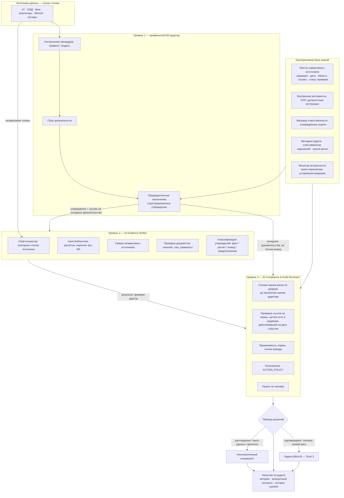

# Специализация ИИ-аудиторов и трёхуровневая проверка достоверности

Версия 0.1 · 2026-10-17 · статус: **проект на согласование, код не начат**.
Связанные документы: [паспорта компетенций](04-competence-passports.md) ·
[реестр нормативных источников](templates/13_knowledge_sources.csv) ·
[план Этапа 1](01-system-audit-and-stage1-plan.md) ·
[чек-лист запуска](02-launch-checklist.md).

---

## 0. Исходное состояние: что из перечисленного уже есть

Требование «сохранить» относится к тому, что существует. Честный статус:

| Компонент | Статус в коде |
|---|---|
| 16 агентов контроля | Есть как описания (`registry.ts`), расчётов не делают |
| Центр контроля, кейсы, согласования, журнал | Есть, на демо-данных; согласования и журнал не сохраняются (решается в Этапе 1) |
| Интеграция с Bitrix24 | **Нет.** Запланирована на Этап 2 |
| Виртуальный стратегический совет | **Нет нового модуля.** Есть старая статическая страница; новый совет — Этап 4 |

Предлагаемая система проверки встраивается в Этап 1 (логика кейсов) и не
требует Bitrix24 и совета, чтобы начать работать.

---

## 1. Главный принцип

**Квалификация агента — это не текст в промпте, а то, что можно проверить.**
Агент считается квалифицированным в своей области, только если одновременно:

1. **Есть база знаний:** нормы и регламенты его области загружены, у каждой
   известны редакция, дата и первоисточник, и юрист или владелец процесса
   подтвердил их актуальность.
2. **Сдан квалификационный набор:** агент проверен на эталонных кейсах,
   размеченных живым экспертом. Порог качества утверждает директор по контролю.
3. **Качество подтверждается в работе:** метрики раздела «Качество AI-аудита»
   держатся выше порога. Если качество падает, автономия агента автоматически
   снижается.

Если хотя бы одно условие не выполнено, агент работает в режиме «пилот»: его
выводы не порождают задач без проверки человеком.

---

## 2. Архитектура



### 2.1. Где ИИ-модель используется, а где запрещена

| Операция | Чем выполняется | Почему |
|---|---|---|
| Выявление отклонения по порогу | Детерминированное правило (SQL/TypeScript) | Повторяемо и проверяемо |
| Любые суммы, проценты, количества | Только код, **никогда** ИИ-модель | Модели ошибаются в арифметике |
| Пересчёт у верификатора | Отдельная библиотека расчётов, написанная независимо от кода аудитора | Ошибка в коде аудитора не повторяется |
| Поиск аномалий без жёсткого порога | Статистическая модель | Выводы такой модели всегда требуют проверки |
| Текст заключения, разбор отзывов, сопоставление с регламентом | ИИ-модель с обязательными ссылками на источник | Неструктурированный текст |
| Проверка, что цитата нормы существует | Точное сравнение строк с текстом редакции в базе знаний | ИИ не может «подтвердить» собственную цитату |
| Решение «нужен человек» | Правила таблицы решений + оценка ревьюера; правило всегда сильнее | Отвечает за последствия человек |

### 2.2. Как снижается риск, что все три уровня повторят одну ошибку

1. **Разные данные.** Верификатор читает источник своим коннектором, а не
   берёт выгрузку аудитора.
2. **Разные инструменты.** Аудитор и верификатор считают разными
   реализациями. Расхождение больше допуска само считается находкой.
3. **Слепая оценка.** Ревьюер сначала классифицирует риск по исходным
   доказательствам, не видя оценки аудитора, и только потом сравнивает.
4. **Разные модели.** Для уровней 1 и 3 используются разные ИИ-модели или
   хотя бы разные промпты и разные наборы правил. Окончательно решается
   после выбора провайдера (шаг K чек-листа).
5. **Человек как внешний уровень.** Выборочный контроль (раздел 6) ловит
   ошибки, которые пропустили все три уровня.

---

## 3. Корпоративная база знаний

### 3.1. Состав

| Раздел | Что хранится | Кто подтверждает актуальность |
|---|---|---|
| Законодательство РК | Кодексы, законы, приказы МЗ, МФ и др. | Юрист |
| Отраслевые и международные стандарты | МСФО, GPP/GDP (ВОЗ, PIC/S), стандарты внутреннего аудита (IIA), COSO, ISO | Ответственный по направлению; тексты — только лицензионные копии |
| Внутренние регламенты и СОП | Шаблон 09 чек-листа | Владелец процесса |
| Должностные инструкции | По должностям из шаблона 06 | HR |
| Матрица ответственности | Шаблон 07 | Директор по контролю |
| Финансовые и операционные политики | Кредитная, закупочная, ценовая политики | Финансовый директор, владельцы |
| Методики внутреннего аудита | Классификатор нарушений, шкала риска, правила выборки | Директор по контролю |
| Контрольные показатели | Шаблон 10 (утверждённые пороги) | Директор по контролю |

### 3.2. Карточка источника (обязательные поля)

| Поле | Пример |
|---|---|
| ID | `L-07` |
| Тип | закон / кодекс / приказ / стандарт / регламент / СОП / инструкция / политика / методика / порог |
| Название и реквизиты | «О бухгалтерском учёте и финансовой отчётности», № 234-III, 28.02.2007 |
| Издатель | Парламент РК / МЗ РК / Sadykhan Group |
| **Дата редакции** | Дата последних изменений, по которой загружен текст |
| Действует с / по | Для отбора нормы, действовавшей на дату нарушения |
| Область применения | Какие юрлица, процессы и агенты |
| **Ссылка на первоисточник** | Для законов РК — ИПС «Әділет» (adilet.zan.kz), для регламентов — файл в хранилище |
| Хэш текста | SHA-256 загруженного текста |
| Статус | `не проверен` / `проверен` / `устарел` / `заменён` |
| Проверил, дата | ФИО юриста или владельца, дата |
| Следующий пересмотр | Для законов — ежемесячно, для регламентов — по графику |

### 3.3. Правила использования

1. Агент может сослаться только на источник со статусом `проверен`.
   Источник `не проверен` использовать можно, но с пометкой
   **«Норма не верифицирована»**, и такой кейс всегда уходит человеку.
2. Ссылка на норму = ID источника + статья/пункт + дословная цитата.
   Ревьюер проверяет точным сравнением, что цитата есть в тексте редакции,
   **действовавшей на дату события**.
3. Если подходящего источника нет, агент пишет: **«Данных недостаточно:
   отсутствует подтверждённый источник для …»** и не формулирует нарушение
   нормы. Отклонение от порога при этом всё равно фиксируется как факт.
4. Если редакция источника изменилась, все открытые кейсы со ссылкой на него
   помечаются «Требуется перепроверка нормы».

### 3.4. Состояние на сегодня

Реестр начальных источников — [`templates/13_knowledge_sources.csv`](templates/13_knowledge_sources.csv),
41 позиция. **Все со статусом `не проверен`.** Реквизиты указаны по моим
знаниям, у части позиций пометка «проверить»: именно этот случай описан в
вашем требовании «нельзя считать, что ИИ обладает достоверными знаниями».
Прежде чем агенты начнут на них ссылаться, юрист сверяет каждую позицию с
adilet.zan.kz и вносит дату редакции и ссылку.

---

## 4. Аудиторское заключение как набор проверяемых утверждений

Чтобы заключение можно было проверить, аудитор формирует его не свободным
текстом, а как список **утверждений**, у каждого из которых есть тип:

| Тип утверждения | Пример | Чем подтверждается | Кто проверяет |
|---|---|---|---|
| **Факт** | «Чек № 4512 аннулирован в 20:03 кассиром К-17» | Запись источника (ID, время, хэш) | Верификатор: повторное чтение |
| **Расчёт** | «Доля аннулирований 4,8% при пороге 2%» | Формула + входные факты | Верификатор: пересчёт своей библиотекой |
| **Сравнение источников** | «Чек есть в ОФД, нет в 1С» | Два источника | Верификатор: сверка |
| **Норма** | «Нарушен п. 4.2 СТ-03 Кассовая дисциплина» | ID источника + пункт + цитата | Ревьюер |
| **Вывод** | «Признаки систематического нарушения» | Ссылки на факты и расчёты, на которых он построен | Ревьюер: логика |
| **Предположение** | «Возможно, умысел кассира» | — | Помечается и **не может** быть основанием для задачи |

Заключение также содержит: классификацию риска с критериями по шкале,
рекомендуемые действия (каждое проверяется по `ACTION_POLICY`), ответственного
по матрице и перечень недостающих данных.

---

## 5. Три уровня проверки

### Уровень 1 — профильный ИИ-аудитор

Вход: срабатывание контрольной процедуры. Выход: предварительное заключение
(раздел 4). Статус кейса: **«Предварительный сигнал»**.

### Уровень 2 — AI Evidence Verifier (верификатор доказательств)

| Проверка | Как выполняется | Результат по утверждению |
|---|---|---|
| Наличие первичных документов | Запрос документа по ID в источнике; проверка реквизитов и хэша | есть / нет / не совпадает |
| Повторное чтение факта | Собственный коннектор, свежий запрос | подтверждён / опровергнут / недоступен |
| Пересчёт | Независимая библиотека расчётов, допуск по сумме — 1 ₸, по доле — 0,1 п.п. **[допущение]** | совпадает / расхождение |
| Сверка независимых источников | 1С ↔ ОФД ↔ банк ↔ агрегатор | согласованы / противоречие |
| Корректность ссылок на документы | Ссылка ведёт на существующий документ нужного типа и периода | корректна / битая |
| Факты и предположения | Утверждение без доказательства переклассифицируется в «предположение» | — |
| Существование отклонения | Порог применён к правильному периоду и объекту, исключения учтены (праздники, инвентаризация, техсбой) | подтверждено / не подтверждено |

Вердикт верификатора: **пройдено** / **расхождения** (с перечнем) /
**недостаточно данных** (с перечнем документов).

### Уровень 3 — AI Compliance & Audit Reviewer (методология и право)

Получает **исходные доказательства + утверждения + вердикт верификатора**.

| Проверка | Как выполняется |
|---|---|
| Слепая классификация риска | Оценка по рубрике (раздел 5.1) без доступа к оценке аудитора; затем сравнение |
| Актуальность нормы | Редакция действовала на дату события, статус источника `проверен` |
| Цитата существует | Точное совпадение строки в тексте редакции |
| Применимость | Норма распространяется на этот субъект и процесс (розница / опт / онлайн; юрлицо; вид деятельности) |
| Соответствие регламенту | Нарушение действительно соответствует пункту, на который ссылается аудитор |
| Логика | Каждый вывод опирается на подтверждённые факты; нет перехода «корреляция → умысел» |
| Рекомендации | Каждое действие допустимо по `ACTION_POLICY` и соразмерно риску |
| Полномочия | Аудитор не предлагает действий за пределами паспорта (поле 10) |
| Нужен ли человек | По правилам раздела 5.2; ревьюер может только **ужесточить**, но не смягчить |

Вердикт ревьюера: **пройдено** / **замечания** (с перечнем) / **передать
специалисту** (с причиной).

### 5.1. Рубрика классификации риска (проект)

| Уровень | Критерии (достаточно одного) |
|---|---|
| Критический | Угроза жизни и здоровью (качество ЛС, отозванная серия, холодовая цепь); признаки хищения; риск приостановки лицензии; сумма ≥ [порог К] ₸ |
| Высокий | Нарушение законодательства без угрозы здоровью; систематический характер (≥ 3 эпизодов за 30 дней); сумма ≥ [порог В] ₸ |
| Средний | Нарушение внутреннего регламента; разовый эпизод; сумма ≥ [порог С] ₸ |
| Низкий | Отклонение от процедуры без финансовых и правовых последствий |

Пороги в тенге утверждает директор по контролю (добавятся в шаблон 10).

### 5.2. Таблица решений

Правила проверяются сверху вниз, срабатывает первое подходящее.

| # | Условие | Статус кейса | Что происходит |
|---|---|---|---|
| 1 | Риск критический (по аудитору **или** ревьюеру) | **Передан специалисту** | Сразу уведомление ответственным лицам с пометкой **«Предварительный сигнал, требует проверки»**. Если затронут конкретный сотрудник, его имя видят только СБ и директор по контролю |
| 2 | Вывод касается персональной вины, умысла, дисциплинарной или материальной ответственности | **Передан специалисту** | Задача-обвинение не создаётся никогда; создаётся только кейс для специалиста |
| 3 | Верификатор: «недостаточно данных» | **Запрошены документы** | Запрос недостающих документов владельцу данных (задача без обвинительных формулировок); срок; затем повтор уровня 2 |
| 4 | Верификатор: «расхождения» **или** ревьюер: «замечания» **или** оценки риска аудитора и ревьюера разошлись больше чем на 1 уровень | **Требуется дополнительная проверка** | Аудитору — на исправление (1 попытка), затем человеку |
| 5 | Ссылка на норму со статусом `не проверен` | **Передан специалисту** | С пометкой «Норма не верифицирована» |
| 6 | Агент в режиме «пилот» (не сдал квалификацию или упало качество) | **Передан специалисту** | — |
| 7 | Все проверки пройдены, процедура разрешена к авто-задаче, риск низкий/средний, правило детерминированное | **Подтверждён ИИ-проверками** | Задача в Bitrix24 (после Этапа 2) + кейс попадает в генератор выборочного контроля |
| 8 | Все проверки пройдены, но авто-задача для процедуры не разрешена | **Подтверждён ИИ-проверками** | Ожидает решения контролёра |

Статус **«Подтверждён ИИ-проверками»** в интерфейсе всегда сопровождается
подписью: *«Не является окончательным аудиторским или юридическим
подтверждением. Окончательное решение принимает уполномоченный сотрудник».*
Человеческие статусы — отдельные: **«Подтверждён контролёром»**,
**«Отклонён контролёром»**.

### 5.3. Жизненный цикл кейса (дополнение к плану Этапа 1)

```
Предварительный сигнал
  → На проверке ИИ (уровень 2 → уровень 3)
      → Подтверждён ИИ-проверками → [задача / решение контролёра]
      → Требуется дополнительная проверка → аудитор исправляет → повтор уровней 2–3 | человек
      → Запрошены документы → документы получены → повтор уровня 2
      → Передан специалисту
  → Подтверждён контролёром | Отклонён контролёром
  → Устранение → Повторный контроль → Закрыт
```

---

## 6. Качество AI-аудита

### 6.1. Новый раздел портала «Качество AI-аудита»

| Показатель | Как считается |
|---|---|
| Проверено кейсов | Кейсы, прошедшие уровни 2–3 за период |
| Подтверждено нарушений | Подтверждены человеком (выборка + переданные специалисту) |
| Отклонено заключений | Отклонены верификатором, ревьюером или человеком — отдельно по каждому |
| Ложноположительные срабатывания | Отклонено человеком / проверено человеком |
| Пропущенные нарушения | Из выборки «отрицательного контроля» (раздел 6.2): найдено человеком / проверено |
| Ошибки в нормативных ссылках | Найдено ревьюером + найдено человеком |
| Исправленные заключения | Вернулись на исправление по правилу 4 |
| Доля переданных человеку | Правила 1, 2, 5, 6 |
| Расхождения между уровнями | Доля кейсов, где верификатор или ревьюер не согласились с аудитором |
| История ошибок агента | Каждая ошибка: кейс, тип, кто нашёл, исправление |

Все показатели — **по каждому агенту** и в целом, с динамикой по неделям.

### 6.2. Выборочный человеческий контроль

| Выборка | Объём **[предложение]** | Зачем |
|---|---|---|
| Из «Подтверждён ИИ-проверками» | 10% случайно, но не меньше 5 кейсов на агента в месяц | Ложные подтверждения |
| Из отклонённых верификатором и ревьюером | 10% | Не отсекают ли проверяющие настоящие нарушения |
| Отрицательный контроль: операции, по которым сигналов **не было** | 20–50 операций на агента в месяц | Оценка пропущенных нарушений |
| Новый агент или изменённое правило / модель | 100% первые 2 недели | Допуск к работе |
| Критические кейсы | 100% (правило 1) | — |

Выборку формирует система случайным образом с записью параметров в журнал;
проверяющий не выбирает кейсы сам.

### 6.3. Автоматическое снижение автономии

| Условие **[предложение]** | Последствие |
|---|---|
| Ложноположительных > 30% за 4 недели (на ≥ 20 проверенных) | Агент → «пилот»: авто-задачи выключаются |
| Ошибка в нормативной ссылке, найденная человеком | Источник → «перепроверить»; все кейсы с этой ссылкой — повторная проверка |
| Пропущенных > 10% по отрицательному контролю | Пересмотр порогов и правил агента |
| Изменение правила, промпта или модели | Повторная квалификация на эталонном наборе |

### 6.4. Квалификационный (эталонный) набор

Для каждого агента: 30–50 исторических или смоделированных кейсов
**[предложение]**, размеченных экспертом (бухгалтер, провизор, юрист и т.д.):
- нарушения разной тяжести;
- «ловушки», похожие на нарушения, но допустимые (возврат по регламенту, плановая инвентаризация);
- кейсы, где верный ответ — «данных недостаточно».

Допуск к работе — при доле верных ответов не ниже порога, утверждённого
директором по контролю. Набор используется повторно при каждом изменении агента.

---

## 7. Встраивание в существующую систему

### 7.1. Агенты: что сохраняется, что добавляется

Действующие 16 агентов **сохраняются**. Их функции распределяются по
профильным аудиторам (как в плане Этапа 1), добавляются 3 аудитора и 2
проверяющих:

| Профильный аудитор (паспорт) | Включает действующих агентов |
|---|---|
| Аудитор аптечной сети (Retail) | `cash-fraud`, `revision` |
| Аудитор опта (Wholesale) | `receivables` |
| Аудитор e-commerce | `aggregators`, `online-orders` |
| Финансовый аудитор | `finance-control` |
| Аудитор бухгалтерии | **новый** |
| Аудитор закупок | `procurement-price` |
| Аудитор склада и логистики | `gdp-warehouse` (операционная часть) |
| Аудитор качества GPP/GDP | `gpp`, `gdp-warehouse` (качество, отзывы серий, температура) |
| Аудитор кадровых процессов | `hr-control` |
| Аудитор клиентского сервиса | `reputation`, `service-audio` |
| Аудитор IT и доступов | `access-control` |
| Аудитор юридического блока | **новый** |
| Аудитор маркетинга и программ лояльности | **новый** |

| Модуль платформы | Действующий агент |
|---|---|
| Оркестратор МОЗГ | `mozg` |
| Контроль исполнения | `execution` |
| Ассистент аудитора → **сервис базы знаний** | `auditor-assistant` |
| **AI Evidence Verifier** | новый |
| **AI Compliance & Audit Reviewer** | новый |

### 7.2. Изменения в интерфейсе

| Где | Что добавляется |
|---|---|
| Карточка кейса | Блок «Проверка достоверности»: три уровня с вердиктами; таблица утверждений (тип, доказательство, результат проверки); ссылки на нормы со статусом источника; расхождения; «Данных недостаточно: …»; подпись о том, что ИИ-проверка не является окончательной |
| Кейсы | Фильтры по новым статусам («Требуется дополнительная проверка», «Запрошены документы» и др.) |
| Новый экран «Паспорта аудиторов» | 10 полей паспорта, статус квалификации, привязанные источники |
| Новый экран «База знаний» | Реестр источников со статусами, сроками пересмотра, предупреждениями об устаревших редакциях |
| Новый экран «Качество AI-аудита» | Показатели раздела 6, очередь выборочного контроля, история ошибок |
| Журнал | Записи уровней 2 и 3, выборки, изменения статусов источников |

### 7.3. Изменения в модели данных (к плану Этапа 1)

Новые сущности: `KnowledgeSource`, `SourceEdition`, `CompetencePassport`,
`Claim`, `VerificationRun` (уровень, вердикт, находки, версия инструмента и
модели), `ReviewSample`, `QualificationRun`, `AgentQualityMetric`. Все
результаты проверок пишутся в неизменяемый журнал.

---

## 8. План реализации после согласования

Разбит так, чтобы работающая часть появлялась без ожидания ИИ-модели и интеграций.

| Шаг | Что | Зависит от | Оценка **[предв.]** |
|---|---|---|---|
| V1 | Модель данных: паспорта, источники, утверждения, проверки; паспорта 13 аудиторов + 2 проверяющих как данные; таблица решений как код с тестами на все 8 правил | Этап 1 (сервер, БД) | 1,5 нед. |
| V2 | Верификатор, детерминированная часть: независимая библиотека расчётов, сверка источников, проверка документов и ссылок | V1 | 1,5 нед. |
| V3 | Ревьюер, детерминированная часть: проверка цитат по тексту редакции, действие нормы на дату, `ACTION_POLICY`, правила «нужен человек», рубрика риска | V1, реестр источников | 1 нед. |
| V4 | Интерфейс: блок проверки в карточке кейса, «Паспорта», «База знаний», «Качество AI-аудита» | V1–V3 | 1,5 нед. |
| V5 | Выборочный контроль, метрики, автоматическое снижение автономии | V4 | 1 нед. |
| V6 | ИИ-модель: формирование заключений, слепая оценка ревьюера, разбор текстов | Шаг K чек-листа (выбор модели) | 2 нед. |
| V7 | Квалификация агентов на эталонных наборах | Эксперты размечают наборы | по агенту |

В демо-режиме V1–V5 работают на демо-кейсах, явно помеченных «Демо».

### Тестирование

- Таблица решений: тест на каждое правило и их приоритет.
- Верификатор: подложенная ошибка в расчёте аудитора обнаруживается; опровергнутый факт; отсутствующий документ.
- Ревьюер: несуществующая цитата; норма, не действовавшая на дату события; источник `не проверен`; рекомендация вне `ACTION_POLICY`; предположение как основание задачи.
- Запрет: ни один путь не создаёт дисциплинарную задачу без человека.
- Выборка: случайность и запись в журнал; проверяющий не может подменить кейсы выборки.

---

## 9. Что нужно от вас для согласования

1. **Согласовать архитектуру**: три уровня, таблицу решений из раздела 5.2,
   правило «ИИ не считает цифры».
2. **Согласовать паспорта** ([04-competence-passports.md](04-competence-passports.md)):
   набор из 13 аудиторов (3 новых: бухгалтерия, юридический блок, маркетинг)
   и 2 проверяющих.
3. **Утвердить или скорректировать предложения**: объём выборочного контроля
   (10%), порог снижения автономии (30% ложных), объём эталонного набора (30–50 кейсов).
4. **Назначить экспертов** для разметки эталонных наборов и проверки
   источников: юрист (законы), главный бухгалтер (учёт, налоги), уполномоченное
   лицо по качеству (GPP/GDP), HR, финансовый директор.
5. **Юрист верифицирует реестр** [`13_knowledge_sources.csv`](templates/13_knowledge_sources.csv):
   реквизиты, дата редакции, ссылка на adilet.zan.kz, статус.
6. **Лицензионные копии стандартов** (МСФО, ISO), если компания ими владеет.
   Иначе в базе будут только ссылки и выдержки, подготовленные экспертами компании.

После согласования начинаю с шагов V1–V3 в составе Этапа 1.
