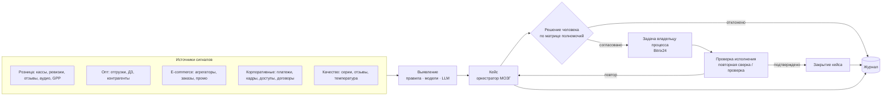
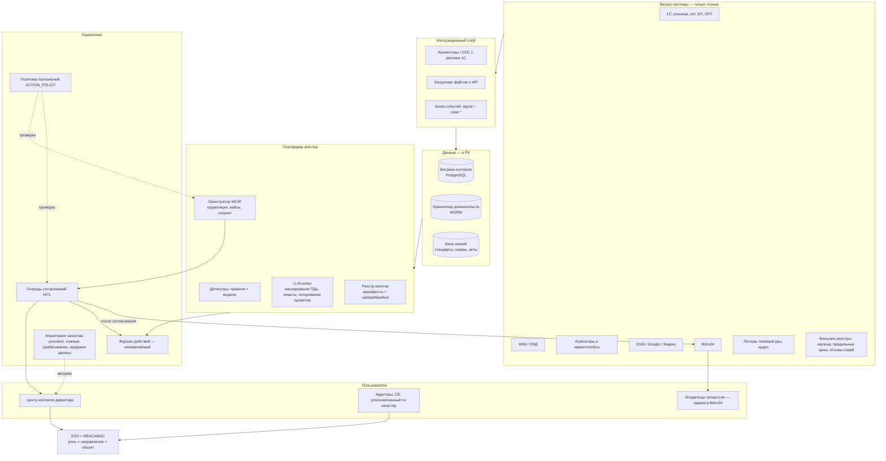

# AI-экосистема департамента контроля качества и аудита

Версия 0.1 · черновик архитектора · все цифры в интерфейсе — демо.
Где нет подтверждённых данных, в тексте стоит **[допущение]** или
**[уточнить]**. Опросник с вопросами к бизнесу: [`00-diagnostics.md`](00-diagnostics.md).

Реализация в коде: портал `/portal` → «Контроль и аудит» → «Центр контроля»,
«Кейсы», «Согласования», «Агенты контроля», «Сценарии», «Журнал».

| Что | Где в коде |
|---|---|
| Контракт агента, кейса, согласования | `src/lib/control/types.ts` |
| Матрица полномочий, проверка манифестов, риск-скоринг | `src/lib/control/policy.ts` |
| Реестр агентов (все 13 полей по каждому) | `src/lib/control/registry.ts` |
| Сквозные сценарии | `src/lib/control/scenarios.ts` |
| Демо-данные | `src/lib/control/demo.ts` |
| Интерфейс директора | `src/components/control/ControlTower.tsx` |

---

## 1. Стратегическая концепция

**Роль департамента.** Это не одно из направлений, а независимая надзорная
функция над всеми направлениями: розницей, оптом, e-commerce, финансами,
закупками, складом и логистикой, HR, IT и юридическим блоком. В терминах
модели «трёх линий защиты» бизнес-подразделения — первая линия (владеют
процессами и рисками), департамент — вторая и третья (мониторинг, проверки,
расследования).

**Пользователь экосистемы** — директор департамента. Его вопрос каждое утро:
*«Где в группе сейчас теряются деньги, нарушаются стандарты или не исполняются
предписания — и что из этого требует моего решения сегодня?»*

**Ключевые принципы.**

1. **Независимость.** Агенты контроля читают данные бизнес-систем (через
   реплику / витрину), но **ничего в них не меняют**. Они открывают кейс,
   ставят задачу владельцу процесса и проверяют исполнение. Корректировку в
   1С делает бухгалтерия, остановку отгрузок — директор опта, отзыв доступа —
   ИБ. Иначе контроль начинает проверять сам себя.
2. **Кейс — единица работы.** Сигнал → кейс → доказательства → решение
   человека → задача владельцу → проверка исполнения → закрытие. Разрозненные
   «алерты» не приносят пользы, пока не превращаются в кейс с владельцем и
   сроком.
3. **Минимально достаточный ИИ.** Из 16 решений только одно — автономный
   агент (оркестратор, и то с правом лишь открывать кейсы и уведомлять).
   Сверки и сроки — классическая автоматизация, аномалии — аналитические
   модели, LLM — там, где есть неструктурированный текст или речь.
4. **Человек решает всё, что влияет на людей, деньги, товар и регулятора.**
   Это зашито в коде (`ACTION_POLICY`), а не только в регламенте: манифест
   агента, который пытается выполнять действие выше L1, не проходит проверку
   `validateManifest`.
5. **Доказуемость.** Каждое действие агента и человека пишется в
   неизменяемый журнал вместе с доказательствами — это нужно и для внутренних
   расследований, и для трудовых споров, и для проверок регулятора.

---

## 2. Карта процессов контроля



| Процесс департамента | Сейчас **[допущение]** | С экосистемой |
|---|---|---|
| Мониторинг операций | Выборочно, постфактум, Excel | Ежедневно, 100% операций по правилам |
| Планирование проверок | По календарю | По риск-скорингу объекта |
| Расследования | Сбор данных вручную из разных систем | Кейс с доказательствами из нескольких источников |
| Предписания | Выдаются, исполнение не проверяется | Задача + срок + повторная проверка |
| Отчётность руководству | Ручные отчёты | Утренний доклад + центр контроля |
| Комплаенс GPP/GDP | Журналы, проверки | Сроки, отклонения, отзывы серий — автоматически |

---

## 3. Реестр агентов и приоритеты

Полная карточка (13 полей: назначение, владелец, проблема, данные,
интеграции, анализ, авто-действия, действия с согласованием, результаты, KPI,
методика эффекта, сложность/срок, риски) — в `registry.ts` и в интерфейсе
«Агенты контроля».

| # | Агент | Направление | Тип | Волна | Сложность | Срок **[предв.]** |
|---|---|---|---|---|---|---|
| 1 | МОЗГ-Контроль (оркестратор) | Группа | Автономный агент | 1 | Высокая | 8–12 нед. |
| 2 | Антифрод касс и лояльности | Розница | Аналитическая модель | 1 | Средняя | 6–8 нед. |
| 3 | Сверка агрегаторов и маркетплейсов | E-commerce | Автоматизация | 1 | Низкая | 3–5 нед./канал |
| 4 | Контроль дебиторки и контрагентов | Опт | Аналитическая модель | 1 | Средняя | 6–8 нед. |
| 5 | Контроль исполнения предписаний | Группа | Автоматизация | 1 | Низкая | 3–4 нед. |
| 6 | Репутация и отзывы | Розница | ИИ-ассистент | 1 | Низкая | работает |
| 7 | Ревизии и недостачи | Розница | Автоматизация | 2 | Низкая | 4–6 нед. |
| 8 | GPP-комплаенс аптек | Розница | Автоматизация | 2 | Средняя | 6–8 нед. |
| 9 | GDP, склад и отзыв серий | Склад/логистика | Автоматизация | 2 | Средняя | 6–10 нед. |
| 10 | Контроль закупок и цен | Закупки | Аналитическая модель | 2 | Средняя | 6–8 нед. |
| 11 | Финансовый контроль платежей | Финансы | Аналитическая модель | 2 | Средняя | 6–8 нед. |
| 12 | Контроль доступов (SoD) | IT | Автоматизация | 2 | Средняя | 4–6 нед. |
| 13 | Ассистент аудитора (RAG) | Группа | ИИ-ассистент | 2 | Средняя | 4–6 нед. |
| 14 | Контроль качества обслуживания (аудио) | Розница | ИИ-ассистент | 3 | Высокая | 10–14 нед. |
| 15 | HR-контроль | HR | Аналитическая модель | 3 | Средняя | 6–8 нед. |
| 16 | Контроль онлайн-заказов и промо | E-commerce | Аналитическая модель | 3 | Средняя | 4–6 нед. |

**Логика приоритетов.** В волну 1 попадает то, что (а) опирается на данные,
которые почти наверняка уже есть в 1С/ОФД/отчётах агрегаторов, (б) даёт
измеримый эффект в тенге по подтверждённым случаям, (в) несёт низкий
регуляторный риск. Аудиомониторинг сознательно в волне 3: он требует
правового заключения, согласий и инфраструктуры записи, а без этого
превращается в юридический риск, а не в инструмент контроля.

**Стоимость.** Не указываю в тенге — нет данных о ставках команды,
выбранном облаке и объёме LLM-запросов. Оценка трудозатрат в неделях дана
выше; перевод в деньги — по формуле раздела 9 после ответа на вопросы 43,
50–52 опросника.

---

## 4. Архитектура



**Решения и почему.**

| Компонент | Решение | Обоснование |
|---|---|---|
| Доступ к 1С | Реплика / регламентные выгрузки в витрину, не прямые запросы к рабочей базе | Не нагружать учёт; независимость контроля; агенты физически не могут писать в 1С |
| Витрина | PostgreSQL в РК **[уточнить облако/ЦОД]** | Требование локализации ПДн; Supabase-проект можно оставить только для обезличенных демо-данных |
| События | Таблица-очередь в PostgreSQL на старте, брокер (NATS/Kafka) — при росте | Не вводить инфраструктуру раньше объёма |
| LLM | Через единый шлюз; в модель уходят только обезличенные данные | ПДн и медицинские данные не покидают контур без правового основания |
| Подключение нового агента | Манифест в реестре + детектор + подписка на сигналы | Портал, очередь согласований и журнал не переписываются |
| Права | Роль × направление × объект (директор розницы не видит кейсы HR, заведующая — только свою аптеку) | Требование «drill-down с учётом прав доступа» |
| Журнал | Append-only, хэш-цепочка, хранение не менее срока исковой давности **[уточнить у юриста]** | Доказательная сила |
| Резервирование | Ежедневный бэкап витрины и доказательств, RPO 24 ч / RTO 8 ч на старте **[допущение]** | Контроль не критичен для продаж — не переплачивать за горячий резерв |

---

## 5. План интеграций

| Система | Что берём | Способ | Волна | Владелец данных | Открытый вопрос |
|---|---|---|---|---|---|
| 1С розница / опт | Чеки, сторно, остатки, серии, отгрузки, ДЗ, лимиты, права | Реплика или регламентная выгрузка | 1 | IT / 1С | Конфигурации и число баз (опросник, в. 7) |
| ККМ / ОФД | Чеки в реальном времени | API ОФД | 1 | Бухгалтерия | Какой ОФД (в. 8) |
| Агрегаторы | Заказы, отмены, выплаты, комиссии | API или ежедневные отчёты | 1 | E-commerce | Есть ли API-доступ |
| Bitrix24 | Создание задач, статусы | REST API, вебхуки | 1 | IT | Облако или коробка (в. 9) |
| 2GIS и др. | Отзывы | Существующий модуль | 1 | Контроль | Ключ API 2GIS Business |
| 1С БП + выписки | Платежи, договоры | Выгрузка | 2 | Финансы | Доступ только к выпискам |
| 1С ЗУП | Приказы, табель, сертификаты | Выгрузка, обезличивание | 3 | HR | Правовое основание |
| Логгеры | Температура | API вендора / CSV | 2 | Качество | Есть ли логгеры вообще |
| Реестры РК | Юрлица, предельные цены, отзывы серий | Загрузка из официальных источников | 2 | Контроль | Какие источники доступны машинно |
| Аудиосистема | Записи | Выгрузка в контур РК | 3 | Розница | Согласия, хранение |

---

## 6. Сквозные сценарии

12 сценариев с шагами и точками согласования — в `scenarios.ts` и на экране
«Сценарии». Кратко:

| # | Сценарий | Направления | Точка согласования |
|---|---|---|---|
| S01 | Комплексная аномалия аптеки (фрод + текучесть + жалобы) | Розница, HR | Служебное расследование (L3) |
| S02 | Отложенные и аннулированные чеки | Розница, финансы | Запрос объяснения (L2) |
| S03 | Заказ агрегатора не отражён в 1С | E-commerce, финансы | Корректировка учёта (L3) |
| S04 | Отгрузки должнику сверх лимита | Опт, финансы | Остановка отгрузок (L3) |
| S05 | Отзыв серии регулятором | Склад, розница, e-commerce | Блокировка продаж (L3) |
| S06 | Температурное отклонение | Склад | Карантин (L2), списание (L3) |
| S07 | Переплата поставщику / предельные цены | Закупки | Запрос обоснования (L2) |
| S08 | Дубль или необоснованный платёж | Финансы | Запрос (L2); возврат — только человек |
| S09 | Доступ уволенного, конфликт полномочий | IT, HR | Отзыв доступа (L3) |
| S10 | Отказ покупателю из-за отсутствия препарата | Розница, закупки | Контроль передаёт сигнал владельцу, сам не заказывает |
| S11 | Нарушение GPP по чек-листу | Розница | Предписание (L2) |
| S12 | Истекающие сертификаты и лицензии | HR, юр., розница | Эскалация (L2) |

---

## 7. Центр контроля (дашборд директора)

| Экран | Что видит директор | Действия |
|---|---|---|
| **Центр контроля** | KPI (открытые кейсы, ждут решения, оценка риска, просрочки), тепловая карта направление × категория риска, топ объектов по риск-скорингу, критические кейсы, состояние агентов | Клик по ячейке / объекту → кейсы с фильтром |
| **Кейсы** | Все кейсы с фильтрами по направлению, категории, объекту; доказательства из разных источников | Раскрыть кейс, перейти к согласованию |
| **Согласования** | Очередь предложений агентов, уровень риска, кто ещё должен согласовать | Согласовать / отклонить (только своей ролью) |
| **Агенты контроля** | Реестр с классификацией и волнами | Карточка агента |
| **Сценарии** | Сквозные цепочки | — |
| **Журнал** | Все действия агентов и людей | Фильтр, экспорт **[следующий шаг]** |

Сделано в текущей итерации: все шесть экранов, drill-down
«группа → направление → объект → кейс → доказательства», работающая очередь
согласований с проверкой ролей и запись решений в журнал (в памяти браузера,
до подключения бэкенда).

Следующие шаги для дашборда: серверное хранение кейсов и решений, вход через
SSO, разграничение видимости по ролям, динамика показателей (графики трендов
по неделям), экспорт актов, мобильный вид для СБ и уполномоченного по
качеству.

---

## 8. Безопасность, законодательство, полномочия

**Матрица полномочий** — `ACTION_POLICY` в `policy.ts`, отображается на
экране «Согласования».

| Уровень | Что | Примеры |
|---|---|---|
| L0 | Агент делает сам | Чтение, расчёт скоринга |
| L1 | Агент делает сам и уведомляет | Открыть кейс, создать задачу, черновик отчёта |
| L2 | Одно согласование | Запрос объяснения, внеплановая проверка, предписание, карантин серии, публикация ответа на отзыв |
| L3 | Два согласования (контроль + владелец процесса) | Служебное расследование, корректировка учёта, блокировка серии, списание, остановка отгрузок, отзыв доступа |
| Только человек | ИИ не выполняет и не предлагает | Отпуск ЛС, замена препарата, дисциплинарные меры, удержания, платежи и возвраты, уведомление регулятора |

**Правовая рамка (Республика Казахстан).** Перечень для проверки юристом,
а не юридическое заключение:

- Закон РК «О персональных данных и их защите» — согласия, локализация
  хранения ПДн на территории РК, меры защиты. Определяет, где разворачивать
  витрину и что можно отправлять во внешнюю LLM.
- Кодекс РК «О здоровье народа и системе здравоохранения» и надлежащие
  фармацевтические практики (GPP, GDP), утверждённые приказом МЗ РК
  **[уточнить актуальные реквизиты]** — требования к хранению, отпуску,
  отзыву серий, уполномоченному лицу.
- Трудовой кодекс РК — процедура дисциплинарных взысканий и материальной
  ответственности; мониторинг сотрудников (аудио, видео) — с уведомлением и
  согласием.
- Налоговое законодательство в части ККМ — отложенные и аннулированные чеки
  несут налоговый риск, поэтому решения по ним с главным бухгалтером.
- Закон РК об искусственном интеллекте (2025) **[проверить вступление в силу
  и требования к прозрачности и ответственности за решения ИИ]**.

**Технические меры.** Обезличивание перед LLM (ФИО, ИИН, телефоны, номера
карт → токены), запрет передачи аудио и медицинских данных во внешние
модели без правового основания, RBAC/ABAC, шифрование, журнал, ежегодный
пересмотр прав.

**Найденные уязвимости текущего портала** (до подключения реальных данных
обязательно закрыть):

1. Портал `/portal` не требует входа — любой, у кого есть ссылка, видит
   «только для АД и CEO». Нужны SSO и роли.
2. Supabase вызывается из браузера по публичному ключу — для реальных данных
   нужны серверные API и RLS.
3. Иконки Tabler (`ti ti-*`) в портале не подключены, поэтому иконки не
   отображаются — косметика, но заметная.

---

## 9. Методика оценки эффекта (ROI)

Финансовые показатели **не приводятся**, пока нет базовых данных. Методика:

```
Эффект агента за период = Σ подтверждённые выгоды − ложные срабатывания × стоимость проверки
ROI = (Эффект − TCO) / TCO
TCO = разработка + интеграции + инфраструктура + LLM-запросы + сопровождение (≈15–25% от разработки в год [допущение])
Срок окупаемости = TCO / (Эффект в месяц)
```

| Источник выгоды | Как считать | Что нужно для базы |
|---|---|---|
| Снижение потерь (фрод, недостачи) | Сумма по **подтверждённым** кейсам; недостачи — % от оборота до/после против контрольной группы аптек | Недостачи за 12 мес., итоги расследований |
| Возвраты по расхождениям | Фактически восстановленные суммы (агрегаторы, дубли платежей, комиссии) | Реестр расхождений за 3 мес. |
| Дебиторская задолженность | Δ просроченной ДЗ × стоимость денег + Δ списаний безнадёжной ДЗ | Aging ДЗ за 12 мес. |
| Списания по сроку | Δ списаний × себестоимость | Списания за 12 мес. |
| Экономия времени | Часы ручных сверок/отчётов до и после × ставка с налогами | Хронометраж 2 недели |
| Регуляторный риск | Только сценарно, без умножения на «вероятность штрафа» | — |

**Сценарии.** Для каждого агента считаются три сценария: консервативный /
базовый / оптимистичный с явно указанной долей выявляемых случаев
**[допущение, калибруется на пилоте]**. Эффект засчитывается только после
подтверждения человеком; агент, у которого precision < 30% после калибровки
**[допущение]**, пересматривается или выключается.

---

## 10. Дорожная карта

Сроки предварительные, уточняются после технического обследования.

| Период | Что делаем | Результат для директора |
|---|---|---|
| **0–3 мес.** | Ответы на опросник; правовое заключение по ПДн и мониторингу; доступ на чтение к 1С/ОФД/агрегаторам; витрина в РК; SSO и роли в портале; кейсы, очередь согласований и журнал на сервере; агенты волны 1 в пилоте на 3–5 аптеках и 1–2 каналах; снятие базовых показателей | Ежедневный центр контроля на реальных данных пилота |
| **3–6 мес.** | Волна 2: ревизии по риску, GPP, GDP и отзывы серий, закупки, платежи, доступы, ассистент аудитора; двусторонняя интеграция с Bitrix24; калибровка весов скоринга по итогам кейсов; расширение на всю сеть | Риск-ориентированный план проверок, сквозные сценарии S01–S12 |
| **6–12 мес.** | Волна 3: аудиоконтроль (после правового решения), HR-контроль, онлайн-промо; ML-модели аномалий вместо части правил; первая оценка ROI по методике; передача паттерна (реестр, полномочия, журнал) другим департаментам | Отчёт об эффекте за полугодие, решение о масштабировании |

---

## 11. Слабые места, о которых нужно знать заранее

1. **Качество справочников.** Без единого справочника аптек, номенклатуры и
   контрагентов корреляция сигналов даст шум. Это первая задача IT, а не ИИ.
2. **Ложные срабатывания убивают доверие.** Старт с узких правил с высокой
   точностью, расширение — по мере калибровки.
3. **Предписания без проверки исполнения бесполезны.** Агент контроля
   исполнения дешёвый, но без него остальные агенты лишь генерируют задачи.
4. **Независимость легко потерять,** если дать агентам контроля право писать
   в 1С «для удобства». Не давать.
5. **Аудиомониторинг** — самый привлекательный и самый рискованный
   компонент. Только после юриста.

## 12. Что нужно от вас, чтобы перейти от демо к пилоту

1. Какие конфигурации 1С и как получить реплику или регулярные выгрузки.
2. Какой ОФД и есть ли API у агрегаторов.
3. Bitrix24: облако или коробка.
4. Кто в оргструктуре занимает роли из матрицы полномочий (уполномоченный по
   качеству, СБ, ИБ).
5. Где разрешено размещать данные (облако / ЦОД в РК).
6. 3–5 аптек и 1–2 канала для пилота.
